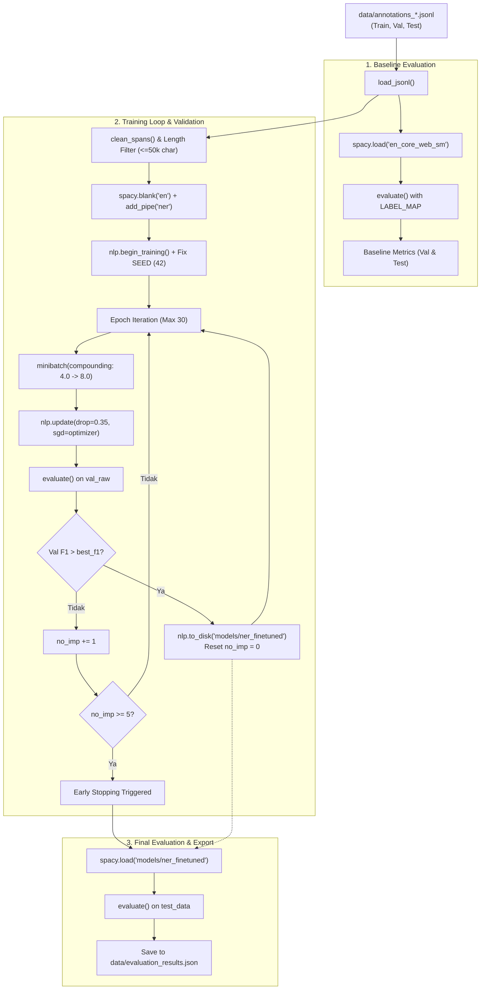

# Panduan & Analisis Mendalam: Mekanisme Kode `train_ner.py`

Dokumen ini menjelaskan secara komprehensif cara kerja dari script [train_ner.py](file:///c:/Users/ghofu/Article-Named-Entity-Recognition-Service-main/Article-Named-Entity-Recognition-Service-main/src/train_ner.py), arsitektur model NER yang digunakan, evaluasi performa, serta panduan praktis area-area modifikasi untuk meningkatkan kualitas dan akurasi model NER.

---

## 1. Ikhtisar & Peran `train_ner.py`

File [src/train_ner.py](file:///c:/Users/ghofu/Article-Named-Entity-Recognition-Service-main/Article-Named-Entity-Recognition-Service-main/src/train_ner.py) adalah modul langkah ke-3 (**Step 3: NER Model Training Pipeline**) dalam arsitektur sistem. 

Fungsi utama dari file ini adalah:
1. **Memuat Dataset Anotasi**: Membaca partisi data (`annotations_train.jsonl`, `annotations_val.jsonl`, `annotations_test.jsonl`) yang telah disiapkan secara deterministik oleh `src/annotation_pipeline.py`.
2. **Evaluasi Baseline**: Menguji model dasar bawaan spaCy (`en_core_web_sm`) pada data validasi dan data uji sebagai tolok ukur acuan (*benchmark*).
3. **Inisialisasi & Fine-Tuning Model spaCy**: Melatih arsitektur *transition-based NER* kosong (`spacy.blank("en")`) khusus untuk 5 kelas target: `PERSON`, `ORG`, `GPE`, `DATE`, `EVENT`.
4. **Early Stopping & Checkpointing**: Memantau skor F1 pada set validasi per epoch, menyimpan bobot model terbaik ke direktori `models/ner_finetuned/`.
5. **Penyimpanan Metrik Evaluasi**: Mengevaluasi model terbaik pada held-out test split dan mengekspor metrik presisi, recall, dan F1 ke `data/evaluation_results.json`.

---

## 2. Arsitektur & Alur Kerja (Workflow Diagram)



---

## 3. Bedah Mekanisme Kode per Fungsi

### A. Konstanta & Hyperparameter Global (Baris 18–24)
```python
SEED = 42
PROJECT_ROOT = Path(__file__).resolve().parent.parent
DATA_DIR = PROJECT_ROOT / "data"
MODEL_DIR = PROJECT_ROOT / "models" / "ner_finetuned"
LABELS = ["PERSON", "ORG", "GPE", "DATE", "EVENT"]
LABEL_MAP = {"PERSON": "PERSON", "ORG": "ORG", "GPE": "GPE", "LOC": "GPE", "DATE": "DATE", "TIME": "DATE", "EVENT": "EVENT"}
```
- `SEED = 42`: Memastikan determinisme dan reproduktifitas pembagian batch dan inisialisasi bobot.
- `LABELS`: 5 entitas inti yang ditargetkan oleh sistem.
- `LABEL_MAP`: Digunakan saat mengevaluasi model bawaan `en_core_web_sm`, karena model umum spaCy memprediksi tag `LOC` (dikonversi ke `GPE`) dan `TIME` (dikonversi ke `DATE`).

---

### B. `clean_spans(entities)` (Baris 31–40)
```python
def clean_spans(entities: list[dict]) -> list[tuple]:
    spans = [(e["start"], e["end"], e["label"]) for e in entities if e["label"] in LABELS]
    spans.sort(key=lambda x: (x[0], -(x[1] - x[0])))
    valid = []
    for s in spans:
        if not valid or s[0] >= valid[-1][1]:
            valid.append(s)
    return valid
```
- **Fungsi**: Mencegah *span collision* (tumpang tindih entitas). Arsitektur transisi spaCy default standar tidak mendukung entitas bertumpuk (*nested/overlapping spans*).
- **Logika**:
  1. Filter hanya entitas yang labelnya ada di daftar `LABELS`.
  2. Mengurutkan span berdasarkan indeks awal (`start`) secara menaik, dan panjang span `-(end - start)` secara menurun (memprioritaskan span yang lebih panjang jika posisinya sama).
  3. Memilih span non-overlapping dengan syarat: `start` span saat ini harus `>= end` dari span terakhir yang valid (`s[0] >= valid[-1][1]`).

---

### C. `evaluate(nlp, dataset, label_map)` (Baris 42–74)
```python
def evaluate(nlp, dataset: list[dict], label_map: dict = None) -> dict:
    ...
```
- **Skema Pencocokan**: **Exact-Span Matching**. Artinya, prediksi dianggap *True Positive* (TP) **hanya jika** posisi karakter awal (`start_char`), karakter akhir (`end_char`), dan `label` sama persis dengan anotasi emas (*gold label*).
- **Metrik yang Dihitung**:
  - $Precision = \frac{TP}{TP + FP}$
  - $Recall = \frac{TP}{TP + FN}$
  - $F1\text{-}Score = \frac{2 \times Precision \times Recall}{Precision + Recall}$
- Dihitung secara per-kategori entitas dan **OVERALL** (mikro-rata-rata kumulatif seluruh entitas).

---

### D. `train_model(train_raw, val_raw, epochs=30)` (Baris 77–118)
Merupakan inti dari proses pelatihan:
1. **Inisialisasi Model Kosong**:
   ```python
   nlp = spacy.blank("en")
   ner = nlp.add_pipe("ner")
   for l in LABELS:
       ner.add_label(l)
   ```
   Membuat pipeline kosong bahasa Inggris dan menyematkan modul `ner`. Model ini belum memiliki bobot ataupun vektor kata (dilatih murni dari scratch pada data korpus).
2. **Kunci Seed**:
   ```python
   random.seed(SEED)
   np.random.seed(SEED)
   spacy.util.fix_random_seed(SEED)
   optimizer = nlp.begin_training()
   ```
3. **Filter Panjang Dokumen**:
   ```python
   train_data = [(d["combined_text"], {"entities": clean_spans(d["entities"])}) 
                 for d in train_raw if len(d["combined_text"]) <= 50000]
   ```
   Dokumen di atas 50.000 karakter diabaikan untuk menghindari *out-of-memory* dan degradasi pada transition parser.
4. **Minibatch Compounding & Dropout**:
   ```python
   for batch in minibatch(train_data, size=compounding(4.0, 8.0, 1.001)):
       examples = [Example.from_dict(nlp.make_doc(t), ann) for t, ann in batch]
       nlp.update(examples, drop=0.35, losses=losses, sgd=optimizer)
   ```
   - `compounding(4.0, 8.0, 1.001)`: Batch size dimulai dari 4 dan membesar secara bertahap hingga mendekati 8.
   - `drop=0.35`: Regularisasi dropout 35% untuk mencegah overfitting.
5. **Early Stopping & Persistence**:
   - Mengevaluasi model pada `val_raw` di setiap akhir epoch.
   - Jika nilai `OVERALL F1` meningkat, model disimpan ke disk (`nlp.to_disk(MODEL_DIR)`), dan counter `no_imp` di-reset ke 0.
   - Jika selama `patience = 5` epoch berturut-turut tidak ada kenaikan F1, pelatihan dihentikan lebih awal (*early break*).

---

### E. `run_pipeline()` (Baris 120–150)
- Menjalankan orkestrasi lengkap:
  1. Memuat file data JSONL.
  2. Mengevaluasi `en_core_web_sm` sebagai baseline.
  3. Menjalankan `train_model()`.
  4. Mengevaluasi model terlatih terbaik pada validation set dan test set.
  5. Menuliskan rekap lengkap ke `data/evaluation_results.json`.

---

## 4. Analisis Kinerja Saat Ini (Kelemahan & Bottleneck)

Berdasarkan data metrik aktual pada `data/evaluation_results.json`:

| Entitas | Precision (Test) | Recall (Test) | F1-Score (Test) | Support (Test) | Keterangan Permasalahan |
| :--- | :---: | :---: | :---: | :---: | :--- |
| **DATE** | **0.8860** | **0.8873** | **0.8866** | 1.331 | Performa sangat baik, pola tanggal relatif teratur. |
| **GPE** | **0.8057** | **0.8025** | **0.8041** | 1.271 | Cukup baik (nama negara/kota seperti Malaysia, KL). |
| **ORG** | 0.7244 | 0.7735 | 0.7481 | 2.671 | Moderat, sering tertukar dengan konteks bisnis/GPE. |
| **PERSON** | 0.5943 | 0.5867 | 0.5905 | 1.788 | **Rendah**. Nama orang memiliki variasi tinggi & gelar. |
| **EVENT** | 0.6400 | **0.5000** | **0.5614** | 32 | **Sangat Rendah (Val F1: 0.3226)**. *Severe class imbalance*. |
| **OVERALL** | **0.7364** | **0.7517** | **0.7440** | 7.093 | Nilai agregat. |

> [!NOTE]
> **Mengapa Baseline `en_core_web_sm` memiliki F1 = 1.0 pada laporan?**
> Karena pada tahap sebelumnya ([src/annotation_pipeline.py](file:///c:/Users/ghofu/Article-Named-Entity-Recognition-Service-main/Article-Named-Entity-Recognition-Service-main/src/annotation_pipeline.py)), *ground truth dataset* dibuat menggunakan metode **weak supervision** yang memanfaatkan `en_core_web_sm` itu sendiri. Oleh karena itu, ketika `en_core_web_sm` diuji terhadap data buatannya sendiri, skornya sempurna (1.0). Sementara model yang dilatih di `train_ner.py` adalah model kosong (`spacy.blank`) yang mencoba merekonstruksi pola tersebut dari awal.

---

## 5. Area Modifikasi untuk Meningkatkan Kualitas Model

Berikut adalah 6 area utama yang dapat Anda modifikasi di dalam kode untuk melipatgandakan akurasi dan ketahanan model:

---

### Area 1: Menggunakan Pre-trained Vectors / Model Backbone (Transfer Learning)
**Tingkat Pengaruh: TERTINGGI (Dapat mendongkrak F1 +10% s.d. +20%)**

*Kelemahan saat ini*:
Di baris 79, model diinisialisasi dengan `nlp = spacy.blank("en")`. Model kosong tidak memiliki pemahaman semantik kata, sinonim, atau representasi linguistik bahasa Inggris.

*Solusi Perubahan*:
Gunakan model yang sudah memiliki pretrained word embeddings (GloVe), misalnya `en_core_web_md` atau `en_core_web_lg`.

```python
# SEBELUM:
# nlp = spacy.blank("en")
# ner = nlp.add_pipe("ner")

# SESUDAH (Fine-tuning Pretrained Backbone):
nlp = spacy.load("en_core_web_md")
ner = nlp.get_pipe("ner")
for l in LABELS:
    ner.add_label(l)

# Hanya latih komponen NER, bekukan (freeze) komponen lain seperti tagger/parser
unaffected_pipes = [pipe for pipe in nlp.pipe_names if pipe != "ner"]
with nlp.disable_pipes(*unaffected_pipes):
    for ep in range(epochs):
        ...
```
*Catatan*: Jika ingin akurasi tingkat *State-of-the-Art* (SOTA), pertimbangkan transisi ke pipeline transformer spaCy (`spacy-transformers` dengan backbone `roberta-base` atau `deberta-v3-base`).

---

### Area 2: Menambahkan Hybrid Pipeline (`EntityRuler` + Statistical NER)
**Tingkat Pengaruh: TINGGI (Sangat efektif untuk nama entitas spesifik domain)**

*Kelemahan saat ini*:
Nama organisasi keuangan lokal (misal: *Maybank*, *Bank Negara Malaysia*, *Bursa Malaysia*, *CIMB*) dan nama acara resmi (*AGM*, *Annual General Meeting*, *EGM*, *Sustainability Summit*) sering luput dipelajari dari data statistik murni yang terbatas.

*Solusi Perubahan*:
Tambahkan modul `EntityRuler` sebelum komponen `ner` di pipeline:

```python
# Tambahkan EntityRuler sebelum ner
ruler = nlp.add_pipe("entity_ruler", before="ner")
patterns = [
    # Pola Organisasi Finansial Spesifik
    {"label": "ORG", "pattern": "Malayan Banking Bhd"},
    {"label": "ORG", "pattern": "Maybank"},
    {"label": "ORG", "pattern": "Bank Negara Malaysia"},
    {"label": "ORG", "pattern": "Bursa Malaysia"},
    {"label": "ORG", "pattern": [{"LOWER": "rhb"}, {"LOWER": "bank"}]},
    
    # Pola Event Spesifik (Memperbaiki F1 EVENT yang rendah)
    {"label": "EVENT", "pattern": [{"LOWER": "annual"}, {"LOWER": "general"}, {"LOWER": "meeting"}]},
    {"label": "EVENT", "pattern": [{"LOWER": "extraordinary"}, {"LOWER": "general"}, {"LOWER": "meeting"}]},
    {"label": "EVENT", "pattern": "AGM"},
    {"label": "EVENT", "pattern": "EGM"},
    {"label": "EVENT", "pattern": [{"LOWER": "press"}, {"LOWER": "conference"}]},
]
ruler.add_patterns(patterns)
```

---

### Area 3: Mengatasi Ketimpangan Kelas (*Class Imbalance Handling*) untuk `EVENT`
**Tingkat Pengaruh: TINGGI (Khusus menaikkan skor kategori EVENT)**

*Kelemahan saat ini*:
Entitas `EVENT` hanya memiliki 19 contoh pada data validasi dan 32 contoh pada data uji (dibandingkan ribuan entitas `ORG` dan `PERSON`). Model statistik cenderung mengabaikan kelas minoritas ini.

*Solusi Perubahan*:
Lakukan **Oversampling** pada dokumen yang memuat entitas `EVENT` saat menyiapkan `train_data`:

```python
# Pada fungsi train_model:
event_docs = [
    (d["combined_text"], {"entities": clean_spans(d["entities"])})
    for d in train_raw
    if any(e["label"] == "EVENT" for e in d.get("entities", []))
]
normal_docs = [
    (d["combined_text"], {"entities": clean_spans(d["entities"])})
    for d in train_raw
    if not any(e["label"] == "EVENT" for e in d.get("entities", []))
]

# Oversample event_docs sebanyak 4-5 kali lipat
train_data = normal_docs + (event_docs * 4)
```

---

### Area 4: Sentence Chunking (Segmentasi Kalimat Teks Panjang)
**Tingkat Pengaruh: SEDANG - TINGGI (Meningkatkan pemahaman konteks & stabilitas memori)**

*Kelemahan saat ini*:
Di baris 89, artikel dimasukkan utuh selama panjang karakter `<= 50000`. Artikel berita yang sangat panjang (ratusan kalimat sekaligus) menurunkan performa transisi NER karena dependensi kalimat awal hingga akhir terlalu jauh dan gradient propagation menjadi tidak stabil.

*Solusi Perubahan*:
Pecah artikel panjang menjadi potongan kalimat atau paragraf (misal 500–1000 karakter per sampel), lalu sesuaikan offset `start` dan `end` masing-masing entitas:

```python
def chunk_document(text: str, entities: list[dict], max_chars: int = 1500) -> list[tuple]:
    """Memecah teks panjang menjadi per paragraf/kalimat dengan penyesuaian span offset."""
    chunks = []
    # Logika split per paragraf atau per tanda titik
    # Rekalkulasi entitas: span['start'] - chunk_start_offset, span['end'] - chunk_start_offset
    ...
    return chunks
```

---

### Area 5: Penyetelan Hyperparameter (*Hyperparameter Tuning*)
**Tingkat Pengaruh: SEDANG (Optimalisasi konvergensi model)**

Berikut adalah parameter di dalam `train_ner.py` yang bisa dioptimalkan:

1. **Kurva Minibatch Compounding (Baris 97)**:
   ```python
   # SEBELUM: Batch size mentok di angka 8 sangat cepat
   size = compounding(4.0, 8.0, 1.001)

   # REKOMENDASI: Mulai dari batch kecil (4) dan biarkan tumbuh hingga 32 atau 64
   size = compounding(4.0, 32.0, 1.05)
   ```
   Batch size yang lebih besar (32) memberikan estimasi gradien yang lebih stabil untuk dataset berita ratusan dokumen.

2. **Skema Dropout Dinamis (Baris 99)**:
   ```python
   # SEBELUM: drop=0.35 konstan
   nlp.update(examples, drop=0.35, losses=losses, sgd=optimizer)

   # REKOMENDASI: Gunakan dropout decay (tinggi di awal untuk eksplorasi, rendah di akhir)
   drop_rate = max(0.15, 0.40 - (ep * 0.01))
   nlp.update(examples, drop=drop_rate, losses=losses, sgd=optimizer)
   ```

3. **Patience & Epoch (Baris 90)**:
   ```python
   # Tingkatkan patience dari 5 ke 8-10 agar model tidak berhenti terlalu dini saat loss berfluktuasi
   patience = 8
   epochs = 40
   ```

---

### Area 6: Peningkatan Kualitas Span Alignment (`char_span`)
**Tingkat Pengaruh: SEDANG (Mencegah token truncation)**

*Kelemahan saat ini*:
Fungsi `clean_spans` hanya memeriksa karakter mentah `start` dan `end`. Terkadang ada entitas yang memotong setengah kata (*misaligned token boundary*, contoh: `Maybank'` atau trailing spasi), yang membuat spaCy membuang seluruh entitas tersebut saat memanggil `Example.from_dict()`.

*Solusi Perubahan*:
Validasi span terhadap token spaCy dengan `doc.char_span(start, end, alignment_mode="contract")`:

```python
def clean_spans_robust(doc, raw_entities: list[dict]) -> list[tuple]:
    valid = []
    for e in raw_entities:
        if e["label"] not in LABELS:
            continue
        # Pastikan span sejajar tepat dengan batas token spaCy
        span = doc.char_span(e["start"], e["end"], label=e["label"], alignment_mode="contract")
        if span is not None:
            valid.append((span.start_char, span.end_char, span.label_))
    
    # Sort and remove overlapping
    valid.sort(key=lambda x: (x[0], -(x[1] - x[0])))
    non_overlap = []
    for s in valid:
        if not non_overlap or s[0] >= non_overlap[-1][1]:
            non_overlap.append(s)
    return non_overlap
```

---

## 6. Ringkasan Matriks Rekomendasi Aksi

| Prioritas | Tindakan Modifikasi | File Terkait | Estimasi Dampak | Kompleksitas |
| :---: | :--- | :--- | :---: | :---: |
| 1 | **Ganti `spacy.blank("en")` ke `en_core_web_md`** | `src/train_ner.py` | +10–15% F1 | Sangat Rendah |
| 2 | **Tambahkan `EntityRuler` untuk bank & kata kunci `EVENT`** | `src/train_ner.py` & `src/app.py` | +20% F1 Event & ORG | Rendah |
| 3 | **Oversampling dokumen dengan kelas `EVENT`** | `src/train_ner.py` | +15% Recall Event | Rendah |
| 4 | **Tuning batch size `compounding(4.0, 32.0, 1.05)` & patience** | `src/train_ner.py` | +2–4% Overall F1 | Sangat Rendah |
| 5 | **Perbaiki Token Boundary Alignment (`doc.char_span`)** | `src/train_ner.py` | +3% Precision | Sedang |
| 6 | **Tingkatkan kualitas weak-supervision di annotation pipeline** | `src/annotation_pipeline.py` | Fondasional | Menengah |
